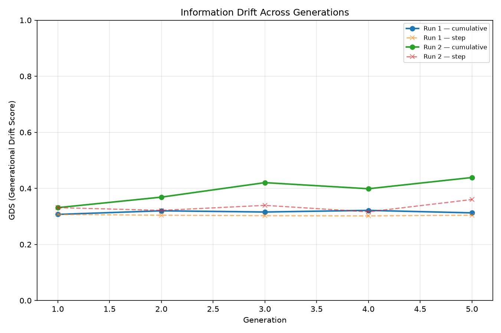

# Information Provenance & Drift in Iterative LLM Rewriting

**An exploratory undergraduate research project on how text changes when language models repeatedly rewrite their own outputs.**

**Status:** Preliminary experiments completed; methodology and validation ongoing.  
**Started:** August 2026  
**Researcher:** Divya Deepika Thodati, B.Tech Data Science, AVN Institute of Engineering and Technology, Hyderabad, India.

> This repository was initially developed under the working title **Information Half-Life**. The current experiments measure exploratory text drift, **not** validated factual-claim half-life or provenance depth.

## Research Question

How do successive LLM rewrites change a source passage, and how can we distinguish superficial wording changes from the preservation, mutation, or loss of specific factual claims?

The longer-term aim is to measure claim-level trajectories relative to the original source, including changes in names, dates, quantities, attribution, and uncertainty.

This is a **research goal**, not a result established by the current pilot.

## What Is Implemented

- A recursive rewriting pipeline: generation `G1` is produced from source `G0`, and each subsequent generation is produced from the **previous** generation.
- An exploratory **Generational Drift Score (GDS)** with source-relative (`gds_cumulative`) and previous-step (`gds_step`) variants.
- JSONL logging of generated text, generation number, timestamp, and scores.
- Visualization of GDS values across rewriting generations.
- Two logged five-generation pilot runs using an illustrative Mars-related passage.

**Not yet validated or implemented as finished research:**

- Automatic source-grounded atomic-claim tracking
- Claim-survival and information half-life estimation
- Provenance-depth prediction
- Large-scale evaluation with human annotations

The research PDF in this repository is a **working draft**, not a peer-reviewed publication.

## How the Pilot Works

```text
Original passage (G0)
        |
        v
LLM rewrite (G1) --> LLM rewrite (G2) --> ... --> LLM rewrite (G5)
        |                    |                           |
        +--------------------+---------------------------+
                             |
            Measure source-relative and step-level GDS
                             |
                   Save JSONL logs and a plot
```

The example pipeline contains an **illustrative passage** about a Mars discovery. Its named researcher, date, and scientific claims have not been independently established as factual evidence for this study.

The example serves to test text-transformation behaviour, **not** to validate a NASA news report.

The current prompt asks the model to retell a story conversationally and allows it to omit details. The results therefore test that particular prompting setup; they do not establish that all LLM rewriting inevitably causes factual loss.

## Generational Drift Score (GDS)

The current `src/metrics.py` combines three components:

```text
GDS = 0.4 * semantic_drift
    + 0.3 * diversity_loss
    + 0.3 * entropy_decay
```

- **Semantic drift:** `1 - cosine_similarity(source_embedding, generated_embedding)`, using `all-MiniLM-L6-v2` sentence embeddings.
- **Diversity term:** currently `1 - corpus_diversity(texts)`; `corpus_diversity` itself uses pairwise embedding similarities across the accumulated corpus.
- **Entropy decay:** nonnegative relative drop in word-token Shannon entropy compared with the relevant baseline.

`gds_cumulative` compares each generated text with **G0**.

`gds_step` compares each generated text with the **immediately preceding** generation.

### Measurement Limitations

GDS is an experimental composite score, **not a validated factuality metric**.

In the current implementation, the diversity term can produce a nonzero GDS even for identical texts. Corpus composition and text length can also affect the score.

Its weighting, baseline, and interpretation require revision before using GDS as evidence of factual degradation.

A GDS value must **not** be interpreted as the percentage of factual claims that became false or disappeared.

## Preliminary Experimental Results

The existing `results/pipeline_log.jsonl` contains **two five-generation runs**, recorded on 25 August 2026.

| Run | Cumulative GDS at G1 | Cumulative GDS at G5 | Observation |
| --- | ---: | ---: | --- |
| Run 1 | 0.3072 | 0.3127 | Endpoint scores are similar. |
| Run 2 | 0.3313 | 0.4388 | Endpoint score is higher; several source details disappear. |

The generated text in Run 2 becomes more conversational and no longer preserves some identifying details from the example passage.

These observations are **illustrative only**:

- Two runs are insufficient for a general statistical conclusion.
- The historical log does not save the original source, exact prompt, model version, temperature, or random seed for each run.
- Differences between runs cannot yet be causally attributed to particular settings.
- GDS has not been calibrated against human judgements of factual preservation.

### Pilot Visualization



A separate exploratory metrics check is recorded in `results/gds_log.jsonl`. It is not a claim-level validation experiment.

## Repository Structure

```text
.
├── README.md
├── Research_paper_draft.pdf
├── src/
│   ├── pipeline.py
│   ├── metrics.py
│   ├── visualize.py
│   ├── claims.py
│   └── estimator.py
├── experiments/
│   └── run_experiment.py
└── results/
    ├── pipeline_log.jsonl
    ├── gds_log.jsonl
    └── figures/
        └── gds_drift.png
```

### File Descriptions

| File | Purpose |
| --- | --- |
| `src/pipeline.py` | Recursive LLM rewriting and experiment logging |
| `src/metrics.py` | Exploratory GDS calculations |
| `src/visualize.py` | Generational drift visualizations |
| `src/claims.py` | Reserved for proposed claim-level analysis |
| `src/estimator.py` | Reserved for proposed provenance-depth work |
| `experiments/run_experiment.py` | Reserved for experiment orchestration |
| `results/pipeline_log.jsonl` | Logged rewriting generations |
| `results/gds_log.jsonl` | Exploratory metrics test |
| `Research_paper_draft.pdf` | Working research draft, not a published paper |

## Reproducing the Pipeline

The project uses:

- Python
- Google Gen AI SDK
- Sentence Transformers
- scikit-learn
- NumPy
- Matplotlib

### 1. Create a Python environment

From the repository root:

```bash
python -m venv .venv
```

For Fish shell:

```fish
source .venv/bin/activate.fish
```

### 2. Install dependencies

```bash
python -m pip install google-genai sentence-transformers scikit-learn numpy matplotlib
```

### 3. Configure the API key

Before running, update `src/pipeline.py` so that it reads an environment variable named `GEMINI_API_KEY`, rather than using a literal key or token in the source code.

Use a Gemini model identifier actually available to your account.

Set the secret outside the repository and never commit it to Git.

### 4. Execute the experiment

```bash
python src/pipeline.py
```

### 5. Generate the visualization

```bash
python src/visualize.py
```

The pipeline currently **appends** results to `results/pipeline_log.jsonl`.

Save the existing log separately before rerunning if you want to preserve an unchanged record of the original pilot.

## Current Limitations and Future Research

### 1. Validate the Drift Metric

Test the current GDS formulation using identical-text and controlled-edit baselines.

Correct the diversity component and evaluate sensitivity to text length.

### 2. Improve Experiment Reproducibility

Store the following alongside each experiment:

- Original source passage
- Model name and version
- Exact prompt
- Generation parameters
- Random seed, where available
- Unique experiment/run identifier

### 3. Introduce Source-Grounded Atomic Claims

Extract independently checkable claims from the original source.

At each generation, classify each original claim as:

- **Preserved:** Meaning remains supported and substantially unchanged.
- **Mutated:** Meaning or factual content has changed.
- **Lost:** The original claim is no longer recoverable.

Separately identify newly introduced claims that are unsupported by the source, without assuming that every unsupported claim is necessarily false.

### 4. Conduct Controlled Experiments

Extend testing to:

- Multiple source documents
- Multiple rewriting conditions
- Independent transformation chains
- Different language models
- Human-validated factual annotations

### 5. Investigate Claim Survival

After reliable claim-level annotations are available, investigate:

- The generation where a claim first changes or disappears
- Differences between claim categories
- Whether previously lost or altered claims reappear
- The effects of source anchoring
- The reliability of proposed information half-life measurements

No validated information half-life, factual-accuracy rate, or provenance-depth predictor is claimed at this stage.

## Related Research

The broad problem of information degradation through repeated AI transformations **is already an established research area**.

Relevant publications include:

### LLM as a Broken Telephone: Iterative Generation Distorts Information

ACL 2025

https://aclanthology.org/2025.acl-long.371/

Investigates information distortion across iterative LLM generation and mitigation through prompting.

### Who Remembers What? Tracing Information Fidelity in Human-AI Chains

IJCNLP-AACL 2025

https://aclanthology.org/2025.ijcnlp-long.146/

Studies information fidelity and degradation across multi-step human–AI and LLM transmission chains.

### FActScore: Fine-grained Atomic Evaluation of Factual Precision in Long Form Text Generation

EMNLP 2023

https://aclanthology.org/2023.emnlp-main.741/

Introduces an atomic-fact-based framework for factual precision evaluation.

### Proposed Research Direction

The intended contribution of future work is to investigate **source-grounded, individual-claim trajectories** across recursive transformations.

Whether this constitutes a distinct novel contribution remains to be established through deeper literature comparison and experimental validation.

## Author

**Divya Deepika Thodati**

B.Tech Data Science  
AVN Institute of Engineering and Technology  
Hyderabad, India

GitHub: https://github.com/DeepikaTT

---

*Independent research in progress. Feedback and reproducibility suggestions are welcome.*
